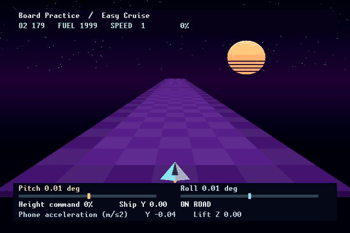

# Neon Roads for original Xbox

Mount an iPhone on a skateboard and use the deck to fly a hover ship along a floating highway. Lean left or right to steer. Tip the nose up to clear a gap, hold it there to stay airborne, and bring the deck level to land. The original Xbox runs the race, plays the soundtrack, and serves the phone controller directly over your home network.

**[Download the playable Xbox build (ZIP)](https://github.com/ZacharyLeahan/neon-roads-nxdk/releases/download/v0.1.0-alpha.2/neon-roads-nxdk-test.zip)** · [Release notes and checksums](https://github.com/ZacharyLeahan/neon-roads-nxdk/releases/tag/v0.1.0-alpha.2)

## Start your first run

1. Extract the ZIP and copy the `NeonRoads` folder to your modded Xbox hard drive. Launch `default.xbe` from the dashboard. Keep `controller.html` beside it.
2. Connect your iPhone to the same local network and scan the QR code on the TV. The Xbox creates its own HTTPS certificate on first launch. If Safari shows a warning, check that the address matches your Xbox before continuing.
3. Secure the phone screen-up with its top toward the nose of the board. Tap **Enable motion** in Safari, then rest the deck flat for two seconds. When the bar on the TV fills, **Easy Cruise** starts.

## Riding the board

Easy Cruise gives you a wide road with clear middle lanes. Move to an outside lane when you want to practice jumping a gap. A sideways lean of 10° gives full steering. Lift either end of the deck to control the ship’s height. A lift as small as 0.5° can reach full height. As you lower the deck, watch for **ON ROAD** on the TV to confirm the landing.

Finish Easy Cruise to reach **First Light**, the first of 30 campaign roads. Rest the board flat before each new road or retry so the game can measure level again. If the phone shifts in its mount, tap **Recenter**. If the TV says **Waiting for phone connection**, bring Safari back to the foreground or scan the on-screen code again.

## Building the Xbox version

The native game and its phone controller live in `xbox/https/`. The build exports the campaign roads and music themes from the TypeScript game. For a ready-to-play installation, follow the install guide. To compile the executable, start with the pinned dependencies. [Install and upgrade](xbox/INSTALL.md) · [Dependency setup](xbox/DEPENDENCIES.md) · [NXDK build and port notes](xbox/README.md)

## Credits

Abhas Tandon created **Neon Roads**, the browser game that provides this port’s campaign roads and musical themes. His game pays tribute to **SkyRoads** (1993) by BlueMoon Software. This fork adds the native Xbox game, Easy Cruise, and the skateboard controls. [Upstream Neon Roads repository](https://github.com/abhas9/neon-roads) · [Play the original browser game](https://abhas9.github.io/neon-roads/) · [MIT license](LICENSE)

| Project | Contribution to the Xbox game |
| --- | --- |
| [XboxDev/nxdk](https://github.com/XboxDev/nxdk) | Toolchain and runtime for building the original Xbox executable |
| [SDL](https://github.com/libsdl-org/SDL) and [lwIP](https://www.nongnu.org/lwip/) | Game audio and local networking |
| [Mbed TLS](https://github.com/Mbed-TLS/mbedtls) and [Jitterentropy](https://github.com/smuellerDD/jitterentropy-library) | On-console HTTPS, certificate generation, and the entropy used to generate keys |
| [Project Nayuki’s QR Code generator](https://github.com/nayuki/QR-Code-generator) | The scannable pairing code on the TV |
